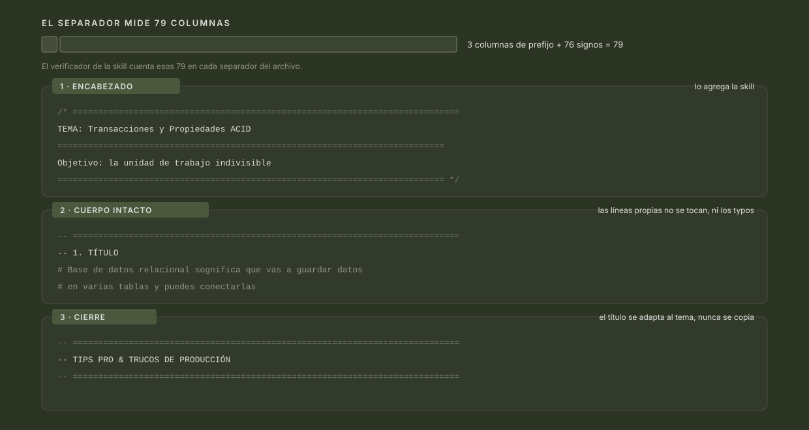

<!-- markdownlint-disable-next-line MD041 -->
<a id="top"></a>

<div align="center">


<h1>Curso SQL Profesional</h1>

<p><strong>Apunte personal del curso de SQL sobre MySQL: una nota por tema, cada una con su encabezado y su cierre.</strong></p>

<p>
<a href="https://github.com/tony-mejia/curso-sql-profesional/stargazers"></a>


</p>

<p>
<a href="#el-curso"><strong>Temario</strong></a> &bull;
<a href="#el-molde-del-apunte"><strong>El molde</strong></a> &bull;
<a href="#empezar-a-leer"><strong>Empezar a leer</strong></a> &bull;
<a href="#pr%C3%A1ctica"><strong>Práctica</strong></a> &bull;
<a href="#convenci%C3%B3n-de-commits"><strong>Convención</strong></a>
</p>

<br/>

<p>
Un curso en video no se puede buscar: a los seis meses el truco del <code>EXPLAIN</code> está en algún minuto del capítulo 10, y el manual es un PDF que se recorre a mano.
<strong>Acá cada tema es un archivo con nombre propio, un encabezado que dice qué es y un cierre con lo que se lleva el lector.</strong>
</p>

<br/>

</div>

<div align="center"></div>

## El curso

El material de origen es **SQL Cero a Experto**: el manual, la base de datos **Northwind** y las respuestas de los ejercicios. Nada de eso está versionado: vive en `Recursos/` y está en el `.gitignore`. Lo versionado son las notas, que son el apunte.

El motor es **MySQL 8.0**. El cliente que usa el curso es **MySQL Workbench**; el pack de práctica trae además los atajos para resolverlo en DBeaver.

| Qué | Dónde vive | ¿Se versiona? |
| :--- | :--- | :--- |
| **Notas del curso** | una carpeta por capítulo, un `.sql` por tema | Sí |
| **Resúmenes** | `Resumen - <tema>.md` dentro de la carpeta del capítulo | Sí |
| **Pack de práctica** | `Queries complejos/Practica/` | Sí |
| **Skill del apunte** | `.pi/skills/mejorar-apunte/` | Sí |
| **Manual, Northwind y respuestas** | `Recursos/` | No: es material descargado |

El objetivo no es tener documentación perfecta, es tener un apunte que dentro de seis meses reconozca como mío.

<div align="right"><a href="#top">Back to top</a></div>

<div align="center"></div>

## Capítulos

Los capítulos del curso, en el orden en que se cursan:

| Cap. | Carpeta | Qué cubre |
| ---: | :--- | :--- |
| 2 | **[Trabajar con una sola tabla](Trabajar%20con%20una%20sola%20tabla/)** | El piso del capítulo: `USE`, `SELECT`, `FROM`, filtros con `WHERE` (`IN`, `BETWEEN`, `LIKE`, `REGEXP`, `IS NULL`), `ORDER BY` y `LIMIT`. Cierra con 10 ejercicios sobre Northwind. |
| 3 | **[Trabajar con Varias Tablas](Trabajar%20con%20Varias%20Tablas/)** | Cruzar tablas: `INNER JOIN` de hasta tres tablas, `LEFT` y `RIGHT JOIN`, self join, `NATURAL JOIN`, `USING`, `CROSS JOIN`, `UNION` y joins entre bases distintas. |
| 4 | **[Trabajar con Datos](Trabajar%20con%20Datos/)** | Escribir datos: `INSERT` de una y de varias filas, `UPDATE`, `DELETE`, copiar una tabla como respaldo, `TRUNCATE` y `LAST_INSERT_ID()` para encadenar altas entre tablas relacionadas. |
| 5 | **[Resumir Datos](Resumir%20Datos/)** | Agregar: `MAX`, `MIN`, `SUM`, `AVG`, `COUNT`, `GROUP BY`, `HAVING` y `WITH ROLLUP`. |
| 6 | **[Queries complejos](Queries%20complejos/)** | Subconsultas ordenadas por dónde viven (`WHERE`, `SELECT`, `FROM`), `IN`, `EXISTS`, `ANY`, `ALL`, la forma correlacionada y la comparación `JOIN` contra subconsulta. |
| — | **[Estructuras JSON](Estructuras%20JSON/)** | Guardar un objeto JSON en una columna y leerlo con `JSON_EXTRACT` y rutas `$.clave`. |

Los capítulos 2 a 6 y JSON llevan además un resumen en Markdown, `Resumen - <tema>.md` dentro de su carpeta: el hilo conductor y los tips que no entraron en las notas.

<div align="right"><a href="#top">Back to top</a></div>

<div align="center"></div>

## Bloques de diseño y administración

Temas que el curso trabaja fuera de la numeración de capítulos:

| Carpeta | Qué cubre |
| :--- | :--- |
| **[Diseñar Bases de Datos](Dise%C3%B1ar%20Bases%20de%20Datos/)** | La cadena de diseño antes de crear la primera tabla: conceptual → lógico → físico, normalización 1FN, 2FN y 3FN, llaves foráneas y sus restricciones, charset y colación, motores de almacenamiento, y las herramientas de Workbench (`Forward Engineer`, `Reverse Engineer`, `Sincronizar Modelo`). |
| **[Modelado de datos](Modelado%20de%20datos/)** | Teoría del modelo relacional: claves primaria, foránea y compuesta, relaciones 1:N y 1:1, y modelado dimensional (tablas de hechos contra tablas de dimensiones). |
| **[Funciones esenciales SQL](Funciones%20esenciales%20SQL/)** | Funciones escalares por tipo (texto, numéricas, fecha y hora) y manejo de nulos y condicionales (`IFNULL`, `COALESCE`, `IF`, `CASE`). |
| **[Vistas](Vistas/)** | Vistas sobre varios `JOIN`, vistas actualizables, y `CREATE OR REPLACE` junto a `DROP`. |
| **[Procesos almacenados](Procesos%20almacenados/)** | Procedimientos (`CREATE`, `CALL`, `DROP`), parámetros `IN` y `OUT`, valores por defecto, variables `DECLARE`, validaciones y funciones propias. |
| **[Eventos Trigger](Eventos%20Trigger/)** | Triggers sobre tablas, incluido el uso como tabla de auditoría, y eventos programados con el event scheduler. |
| **[Transacciones y Concurrencia](Transacciones%20y%20Concurrencia/)** | Propiedades ACID, una transacción real de alta de orden y pago, y bloqueos de fila entre sesiones concurrentes. |
| **[Indexing](Indexing/)** | Qué cuesta indizar, leer el `EXPLAIN` antes y después, índices compuestos, de prefijo y full-text, y cuándo un `OR` deja el índice sin usar. |
| **[Asegurar bases de Datos](Asegurar%20bases%20de%20Datos/)** | Crear usuarios, revisar cuentas y privilegios en `mysql.user`, y conectar MySQL con Excel vía ODBC. |

Las notas viven en 15 carpetas de primer nivel, una por capítulo o bloque; el pack de práctica agrega una más dentro de `Queries complejos/`. Lo que distingue a una nota no es la carpeta: es el molde con el que está escrita.

<div align="right"><a href="#top">Back to top</a></div>

<div align="center"></div>

## El molde del apunte



Un apunte sin forma no se puede leer dos veces: si cada archivo arranca distinto, no sabés si lo que estás mirando es una nota del curso, una consulta suelta o una prueba. La forma es la que hace que el archivo se pueda hojear.

El molde es uno solo, y está medido: el separador lleva **76 signos `=`** y, con el prefijo del comentario delante, ocupa **79 columnas exactas**. El encabezado va entre `/*` y `*/`, abre con `TEMA:` y, cuando entra, sigue con `Objetivo:`; los pasos se marcan con `-- n. TÍTULO`, y el archivo cierra con un bloque cuyo título se adapta al tema en vez de repetirse.

| Bloque | Qué resuelve | Regla |
| :--- | :--- | :--- |
| **Encabezado** | qué es la nota, antes de leer una línea de SQL | `/* */` con `TEMA:` y, si entra, `Objetivo:` |
| **Cuerpo** | las líneas propias del alumno | no se tocan, ni los typos: la mejora es solo agregar alrededor |
| **Separadores** | los pasos de la nota | `-- n. TÍTULO`, solo si la nota tiene pasos |
| **Cierre** | con qué se queda el lector | el título se adapta al tema; nunca se copia uno ajeno |

El molde vive en la skill del repo, `.pi/skills/mejorar-apunte/`, y la skill trae su propio verificador. Se corre después de mejorar una nota y contra el respaldo tomado antes de escribir: comprueba que las líneas propias sigan byte a byte, que no se haya borrado contenido, que los separadores midan 79 caracteres y que los finales de línea no hayan cambiado.

```bash
bash .pi/skills/mejorar-apunte/assets/verifica-apunte.sh "<apunte.sql>" "<respaldo.sql>"
```

Al día de hoy, de las 102 notas, 60 abren con `TEMA:` dentro del encabezado y 35 traen además `Objetivo:`; 63 tienen al menos un separador. Y dos archivos tienen un separador de 60 signos en vez de 76.

<div align="right"><a href="#top">Back to top</a></div>

<div align="center"></div>

## Empezar a leer

Acá no hay nada que instalar: esto no es una librería ni una aplicación, es un apunte. Se clona el repo y se abren los archivos.

```bash
git clone https://github.com/tony-mejia/curso-sql-profesional.git
cd curso-sql-profesional
```

Para ejecutar las consultas hace falta **MySQL 8.0** y la base **Northwind** cargada. Lo único que se arma solo es el pack de práctica: su `00_setup.sql` crea la base `practica_queries` y la carga, así que no depende de Northwind para nada.

| Si venís a | Abrí |
| :--- | :--- |
| **Aprender SQL desde cero** | `Trabajar con una sola tabla/`, empezando por `USE, SELECT y FROM.sql` |
| **Cruzar tablas** | `Trabajar con Varias Tablas/`, empezando por `Join.sql` |
| **Escribir datos sin romper nada** | `Trabajar con Datos/`, y después `Transacciones y Concurrencia/` |
| **Diseñar un esquema** | `Diseñar Bases de Datos/`, de `Modelo Conceptual.sql` en adelante |
| **Practicar con datos que no sean Northwind** | `Queries complejos/Practica/` |
| **Medir por qué una consulta es lenta** | `Indexing/`, empezando por `Crear INDEX-02.sql` |

Cada archivo abre con su encabezado: si el `TEMA:` del encabezado no es lo que buscás, cerrá el archivo y seguí. Es la única tabla de contenidos que hace falta.

<div align="right"><a href="#top">Back to top</a></div>

<div align="center"></div>

## Práctica

`Queries complejos/Practica/` es un paquete aparte, pensado para practicar los patrones del capítulo 6 sin poder copiar las respuestas. Arma la base `practica_queries` con cinco tablas de esquema espejo a Northwind, pero con los datos de otro negocio: una tienda de electrónica llamada ElectroHub.

| Archivo | Qué es |
| :--- | :--- |
| **`00_setup.sql`** | Crea la base y carga todos los datos. Se ejecuta una vez. |
| **`01_desafios.sql`** | Los 10 desafíos: pregunta de negocio, concepto, autochequeo y espacio para escribir. |
| **`02_respuestas.sql`** | Las respuestas, al final. |

El resto de los ejercicios usa la base **Northwind** y vive suelto en la carpeta de su capítulo, como `Ejercicios - <tema>.sql`.

<div align="right"><a href="#top">Back to top</a></div>

<div align="center"></div>

## Convención de commits

El historial es la segunda mitad del apunte: si los mensajes no dicen qué tema tocaron, no sirven para volver. Los commits siguen Conventional Commits, sin cuerpo, y uno por archivo.

| Parte | Regla |
| :--- | :--- |
| **Tipo** | `docs` siempre: es un apunte, no código |
| **Scope** | la carpeta o el tema, en minúsculas: `diseño`, `indexing`, `modelado`, `seguridad`, `transacciones`, `concurrencia`, `bi` |
| **Descripción** | frase nominal en minúsculas que resume el tema del archivo, no la lista de cambios |
| **Cuerpo** | ninguno |

```text
docs(indexing): indices compuestos y regla del prefijo izquierdo
docs(seguridad): crear usuarios con CREATE USER y el par user-host
docs(diseño): primera forma normal y el dominio del atributo
```

Los finales de línea se fijan por `.gitattributes` en LF: esta máquina trabaja con `core.autocrlf=true` y, sin esa regla, los scripts llegan al checkout con CRLF, que rompe el shebang.

<div align="right"><a href="#top">Back to top</a></div>

---

<div align="center">


<br/>

<h3>El apunte se verifica con el molde que lo escribió</h3>

<br/><br/>

<p>No hay <code>LICENSE</code> en el repositorio: es material de estudio personal, no un proyecto para reutilizar.</p>

</div>
